### About me

Head of AI Product at **Samba**, where I lead the AI Task Force. On my own time I build AI agents that run every day, not demos. I'm also getting into training models.

  
  
  
  
  
  
  
  

### What I'm building

| Project | What it is |
|---|---|
| [second-brain-os](https://github.com/the-sid-dani/second-brain-os) | A PARA second-brain OS for Claude Code: memory, routing, guardrail hooks, 25+ skills. Fork it, run `/bootstrap`, done. |
| [career-agent](https://github.com/sidart10/career-agent) | Job-search automation from discovery to tracking. Supervised workflows for Codex and Claude Code, and you approve every submission. |
| [muse-glasses](https://github.com/sidart10/muse-glasses) | Talk to your own Muse from Meta Ray-Ban Display glasses: macOS gadget, bridge, and glasses web app. |
| [zoro-marketing-agent](https://github.com/sidart10/zoro-marketing-agent) | Local-first creative agent for marketing strategy, copy, images, video, and voiceover. |
| [Orion](https://orionagent.ai) | Desktop AI assistant on the Claude Agent SDK. [Architecture docs](https://github.com/sidart10/orion-agent-docs) · [plugin marketplace](https://github.com/sidart10/orion-marketplace) |
| [submagic-mcp-server](https://github.com/sidart10/submagic-mcp-server) | MCP server for automated video captioning with Submagic. |

### Teaching

- **[Mastering Claude Code](https://claude-code-course-beryl.vercel.app/)**: a free, in-depth course on Claude Code ([GitHub Pages edition](https://the-sid-dani.github.io/mastering-claude-code/)).
- Videos on agents and automation at [youtube.com/@siddani09](https://youtube.com/@siddani09).

### Activity

<!-- Generated daily by .github/workflows/metrics.yml (lowlighter/metrics, counts private work) -->

<!-- Generated daily by .github/workflows/snake.yml (Platane/snk) -->
<picture>
  <source media="(prefers-color-scheme: dark)" srcset="https://raw.githubusercontent.com/sidart10/sidart10/output/snake-dark.svg" />
  
</picture>

